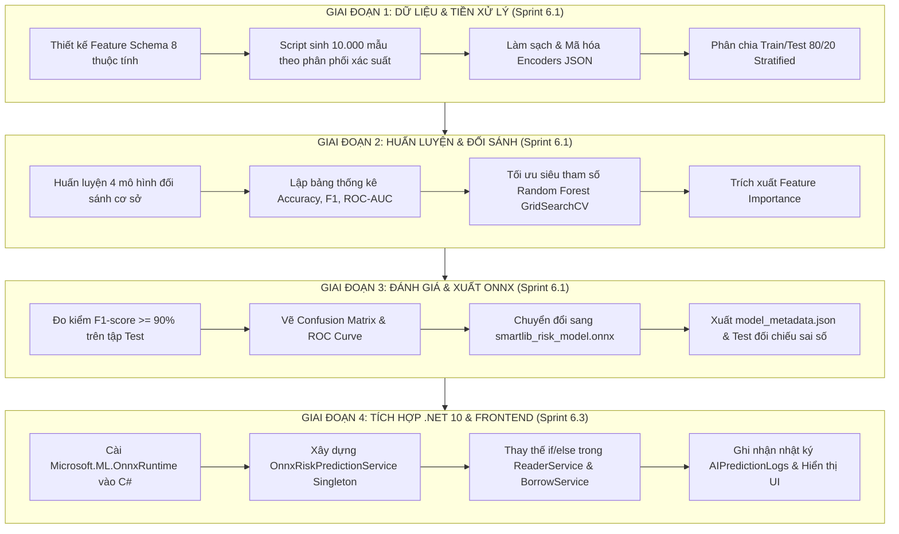

# KẾ HOẠCH TỔNG THỂ PHÁT TRIỂN & TÍCH HỢP AI DỰ BÁO TRỄ HẠN (SMARTLIB AI)

> **Mã đồ án:** LV23-088 | **Hệ thống:** Báo cáo Doanh thu & AI Dự báo Trễ hạn Thư viện  
> **Mục tiêu kỹ thuật:** Độ chính xác $F_1\text{-score} \ge 90\%$, tốc độ phản hồi suy luận $< 5\text{ms}$, nhúng trực tiếp in-process không cần server Python phụ trợ.  
> **Lưu trữ tài liệu:** Nhánh `main` / Thư mục `docs/AI_DEVELOPMENT_PLAN.md`

---

## 1. TỔNG QUAN KIẾN TRÚC & PHƯƠNG ÁN TRIỂN KHAI

### 1.1. Giải pháp vận hành: In-process ONNX Runtime (.NET 10)
Hệ thống **SmartLib AI** áp dụng mô hình phân tách độc lập giữa **Pha Huấn luyện (Training)** và **Pha Vận hành (Serving)**:

* **Pha Huấn luyện (Offline Training - Chạy 1 lần trên môi trường Python):**
  * Dùng Python với Scikit-Learn và Pandas để tiền xử lý dữ liệu, thử nghiệm thuật toán và tinh chỉnh siêu tham số.
  * Xuất ra tệp mô hình nhị phân chuẩn hóa **`smartlib_risk_model.onnx`** và tệp từ điển đặc trưng **`model_metadata.json`**.
* **Pha Vận hành thực tế (In-process Inference - Chạy trực tiếp trong Backend .NET 10):**
  * Tệp `.onnx` được nhúng trực tiếp vào dự án C# (`src/SmartLibAI.Infrastructure/ML/`).
  * Backend sử dụng thư viện chính chủ **`Microsoft.ML.OnnxRuntime`** để suy luận trực tiếp trong bộ nhớ RAM (In-Memory Inference qua C++ Engine tối ưu).
  * **Lợi ích thực tế:**
    1. **Không cần chạy Server Python nền** (tiết kiệm 200–400MB RAM, không sợ rớt tiến trình phụ).
    2. **Độ trễ siêu thấp:** Thời gian suy luận $< 1\text{ms}$ cho mỗi lượt quét thẻ mượn sách.
    3. **Đóng gói độc lập:** Người dùng hoặc hội đồng chấm đồ án chỉ cần chạy `npm run api` và `npm run dev` như bình thường.

---

### 1.2. Lựa chọn Mô hình & Thuật toán tối ưu
* **Mô hình cốt lõi:** **Random Forest Classifier (Rừng cây quyết định)**.
* **Lý do chọn lựa:**
  1. **Tối ưu cho dữ liệu dạng bảng (Tabular Data):** Dữ liệu hành vi mượn trả gồm các thuộc tính số (điểm tín nhiệm, số ngày mượn, số sách đang giữ) và thuộc tính phân loại (khoa viện, nhóm đối tượng). Random Forest xử lý hỗn hợp dạng dữ liệu này vượt trội hơn Deep Learning hay SVM.
  2. **Kháng Overfitting cao:** Hoạt động dựa trên cơ chế kết hợp nhiều cây độc lập (Ensemble Bagging + Random Subspace).
  3. **Xử lý mất cân bằng lớp (Imbalanced Data):** Tỷ lệ trễ hạn thực tế chỉ chiếm khoảng 15–20%. Random Forest cho phép thiết lập trọng số `class_weight='balanced'` để tối ưu hóa trực tiếp chỉ số $F_1\text{-score}$.
  4. **Khả năng giải thích (Explainable AI):** Cung cấp trọng số độ quan trọng đặc trưng (`Feature Importance`), giúp giải trình nguyên nhân cảnh báo rủi ro cao cho bạn đọc.

---

### 1.3. Quy mô dữ liệu: 10.000 mẫu mô phỏng (Synthetic Data)
* **Bản chất:** Hệ thống mới triển khai gặp bài toán khởi động lạnh (**Cold-Start**), chưa có sẵn hàng chục nghìn lượt mượn trả thật.
* **Phương pháp giải quyết:** Sử dụng script Python sinh **10.000 bản ghi mượn trả mô phỏng** tuân theo phân phối xác suất hành vi thực tế của sinh viên (sinh viên điểm tín nhiệm thấp, giữ nhiều sách, mượn vào mùa thi có xác suất trễ hạn cao hơn).
* **Độc lập dữ liệu:** Tệp dữ liệu này lưu dưới dạng file CSV độc lập (`data/borrowing_behavior_dataset.csv`), **hoàn toàn không nạp vào SQL Server** để giữ nguyên vẹn tính sạch sẽ của CSDL thật và các trang báo cáo doanh thu.

---

## 2. MA TRẬN PHÂN CÔNG CÔNG VIỆC TRÊN JIRA BACKLOG

| Mã Task | Sprint | Tên công việc | Đầu ra kỳ vọng (Deliverables) |
| :--- | :---: | :--- | :--- |
| **L0LRA-106** | **6.1** | Xây dựng tập dữ liệu mô phỏng 10.000 bản ghi mượn trả | File script `generate_data.py` & file `borrowing_behavior_dataset.csv` |
| **L0LRA-20** | **6.1** | Thu thập & Tiền xử lý dữ liệu hành vi độc giả | Pipeline làm sạch, mã hóa Encoders, chia Train/Test 80/20 |
| **L0LRA-107** | **6.1** | Huấn luyện đối sánh hiệu năng các mô hình (Baseline) | Bảng đối sánh (Logistic Reg, Decision Tree, Random Forest, XGBoost) |
| **L0LRA-86** | **6.1** | Huấn luyện & Tối ưu mô hình Random Forest Classifier | Tinh chỉnh siêu tham số GridSearchCV, vẽ Feature Importance |
| **L0LRA-87** | **6.1** | Kiểm thử đánh giá mô hình AI & Đo kiểm F1-Score | Báo cáo Classification Report ($F_1 \ge 90\%$), Confusion Matrix |
| **L0LRA-100** | **6.1** | Đóng gói & Export mô hình trained sang ONNX Format | Tệp `smartlib_risk_model.onnx`, `model_metadata.json`, script Smoke Test |
| **L0LRA-88** | **6.3** | Nhúng ONNX Runtime vào .NET 10 API & Tính Credit Score | Tích hợp NuGet `Microsoft.ML.OnnxRuntime`, `AIPredictionService.cs` |
| **L0LRA-21** | **6.3** | Hiển thị nhãn rủi ro AI & Điểm tín nhiệm lên Giao diện | Cập nhật UI Quầy lưu thông (`/circulation`) & Hồ sơ độc giả (`/readers`) |

---

## 3. CHI TIẾT LỘ TRÌNH TRIỂN KHAI 4 GIAI ĐOẠN

---

### GIAI ĐOẠN 1: Chuẩn bị Dữ liệu & Tiền xử lý Đặc trưng (L0LRA-106 & L0LRA-20)
* **Mục tiêu:** Tạo lập bộ dữ liệu chuẩn 10.000 bản ghi và hoàn thiện pipeline chuẩn hóa dữ liệu đầu vào.
* **Các đặc trưng đầu vào (Input Features):**
  1. `Faculty` (Phân loại: CNTT, Kinh tế, Cơ khí, Ngoại ngữ, Luật, Y dược).
  2. `MemberType` (Phân loại: Sinh viên, Giảng viên, Nghiên cứu sinh).
  3. `CreditScore` (Số nguyên: 0 - 100, điểm tín nhiệm độc giả).
  4. `CurrentHoldingBooks` (Số nguyên: 1 - 5, số sách đang giữ tại thời điểm mượn).
  5. `HistoricalOverdueCount` (Số nguyên: Số lần từng trễ hạn trong quá khứ).
  6. `BorrowDurationDays` (Số nguyên: Thời hạn mượn quy định: 14 hoặc 30 ngày).
  7. `TotalCurrentDebt` (Số thực: Số tiền phạt hiện còn nợ, 0 - 100.000 VNĐ).
  8. `IsExamSeason` (Nhị phân: 1 nếu rơi vào tháng 5/tháng 11, 0 nếu tháng khác).
* **Nhãn mục tiêu (Target Label):** `IsOverdue` (0 = Trả đúng hạn, 1 = Bị trễ hạn).
* **Tiêu chí nghiệm thu Giai đoạn 1:**
  * Có tệp `data/borrowing_behavior_dataset.csv` (10.000 dòng, không có giá trị khuyết `NaN`).
  * Có tệp `data/train_data.csv` (8.000 dòng) và `data/test_data.csv` (2.000 dòng) phân bổ đồng đều tỷ lệ nhãn.
  * Có tệp từ điển `data/encoders_metadata.json` lưu bảng ánh xạ danh mục sang số.

---

### GIAI ĐOẠN 2: Huấn luyện Đối sánh & Tối ưu Random Forest (L0LRA-107 & L0LRA-86)
* **Mục tiêu:** Chứng minh tính khoa học của việc chọn Random Forest và tìm ra bộ siêu tham số tốt nhất.
* **Huấn luyện đối sánh 4 mô hình (Baseline Comparison):**
  1. *Logistic Regression:* Mô hình tuyến tính chuẩn đối chiếu.
  2. *Decision Tree:* Cây quyết định đơn lẻ.
  3. *Random Forest Classifier:* Rừng cây kết hợp.
  4. *XGBoost / Gradient Boosting:* Tăng cường độ dốc.
* **Tối ưu siêu tham số Random Forest:**
  * Thuật toán: `GridSearchCV` hoặc `RandomizedSearchCV` kết hợp `5-Fold Cross Validation`.
  * Không gian tìm kiếm: `n_estimators: [100, 200, 300]`, `max_depth: [10, 15, 20, None]`, `min_samples_split: [2, 5, 10]`, `class_weight: ['balanced', 'balanced_subsample']`.
* **Tiêu chí nghiệm thu Giai đoạn 2:**
  * Bảng số liệu và biểu đồ so sánh 4 mô hình để đưa vào báo cáo chương 6.
  * Tệp mô hình Python huấn luyện tối ưu nhất `best_random_forest.pkl`.
  * Báo cáo trọng số `Feature Importance` chỉ rõ các yếu tố ảnh hưởng mạnh nhất đến trễ hạn.

---

### GIAI ĐOẠN 3: Đánh giá Toàn diện & Xuất mô hình ONNX (L0LRA-87 & L0LRA-100)
* **Mục tiêu:** Kiểm định mục tiêu SMART $F_1 \ge 90\%$ và đóng gói mô hình sẵn sàng cho Backend C#.
* **Đo kiểm chất lượng:**
  * Đánh giá trên tập dữ liệu kiểm thử độc lập 2.000 bản ghi (`test_data.csv`).
  * Tính toán: Accuracy, Precision, Recall, $F_1\text{-score}$, ROC-AUC Score.
  * Xuất biểu đồ Ma trận nhầm lẫn (`Confusion Matrix`) và Đường cong ROC (`ROC Curve`).
* **Đóng gói sang định dạng ONNX:**
  * Sử dụng thư viện `skl2onnx` để convert mô hình sang `smartlib_risk_model.onnx`.
  * Xuất file đặc tả `model_metadata.json` chứa: danh sách cột đầu vào, thứ tự tensor, kiểu dữ liệu và ngưỡng phân loại rủi ro (`High Risk >= 70%`, `Medium Risk >= 40%`).
  * Chạy kịch bản kiểm thử đối chiếu (Smoke Test): So sánh kết quả dự báo xác suất của file `.onnx` và file `.pkl` trên 20 mẫu ngẫu nhiên, độ lệch cho phép $< 10^{-5}$.
* **Tiêu chí nghiệm thu Giai đoạn 3:**
  * Báo cáo đánh giá chứng minh $F_1\text{-score} \ge 90\%$.
  * Tệp `smartlib_risk_model.onnx` (< 15MB) đã sẵn sàng.
  * Tệp `model_metadata.json` mô tả rõ ràng schema đầu vào cho lập trình viên Backend.

---

### GIAI ĐOẠN 4: Nhúng vào .NET 10 API & Hiển thị Giao diện (Sprint 6.3 - L0LRA-88 & L0LRA-21)
* **Mục tiêu:** Đưa mô hình AI vào vận hành thực tế in-process và phản hồi lên màn hình web.
* **Tích hợp Backend C# .NET 10:**
  * Cài đặt gói NuGet: `Microsoft.ML.OnnxRuntime` vào dự án `SmartLibAI.Infrastructure`.
  * Tạo dịch vụ `AIPredictionService` (implement `IAIPredictionService`) đăng ký `Singleton` trong `Program.cs`.
  * Viết hàm `PredictRiskScoreAsync(ReaderBehaviorDto dto)` nhận thông tin độc giả và trả về thang điểm rủi ro $0 - 100\%$.
  * Cập nhật `BorrowService.cs`: Khi tạo phiếu mượn mới, tự động gọi AI đánh giá và thêm 1 dòng vào bảng `AIPredictionLogs` trong SQL Server.
  * Cập nhật `ReaderService.cs`: Bỏ hàm `if/else` thủ công cũ, thay bằng điểm số rủi ro do AI tính toán.
* **Hiển thị Frontend React:**
  * Hiển thị cảnh báo rủi ro AI trực tiếp tại cửa sổ popup tạo phiếu mượn của Quầy lưu thông (`/circulation`).
  * Cập nhật bộ lọc và huy hiệu rủi ro trên trang Quản lý Độc giả (`/readers`).
* **Tiêu chí nghiệm thu Giai đoạn 4:**
  * Thời gian phản hồi API dự báo rủi ro $< 5\text{ms}$.
  * Dữ liệu dự báo được lưu chuẩn xác vào bảng `AIPredictionLogs`.
  * Giao diện người dùng hiển thị trực quan thông tin rủi ro và gợi ý hành động của AI.
