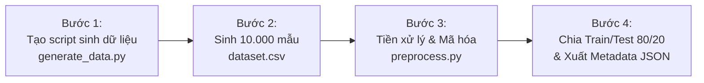

# KẾ HOẠCH HÀNH ĐỘNG CHI TIẾT - GIAI ĐOẠN 1: DỮ LIỆU & TIỀN XỬ LÝ

> **Mã công việc Jira:** `L0LRA-106` & `L0LRA-20`  
> **Thuộc Sprint:** 6.1 (Huấn luyện AI)  
> **Mục tiêu:** Sinh 10.000 bản ghi dữ liệu mượn trả mô phỏng theo phân phối xác suất và đóng gói pipeline tiền xử lý đặc trưng.

---

## 1. THIẾT KẾ ĐẶC TRƯNG ĐẦU VÀO (FEATURE SCHEMA)

Tập dữ liệu sẽ bao gồm **8 đặc trưng độc lập (Features)** và **1 nhãn mục tiêu (Target)** phản ánh toàn diện hành vi độc giả:

| Tên thuộc tính | Kiểu dữ liệu | Khoảng giá trị | Ý nghĩa nghiệp vụ |
| :--- | :---: | :---: | :--- |
| **`Faculty`** | `String / Cat` | CNTT, Kinh tế, Cơ khí, Ngoại ngữ, Luật, Y dược | Khoa / Viện của độc giả tại trường |
| **`MemberType`** | `String / Cat` | Sinh viên, Giảng viên, Học viên SĐH | Loại đối tượng bạn đọc (Giảng viên thường trả đúng hạn hơn) |
| **`CreditScore`** | `Integer` | 0 – 100 | Điểm tín nhiệm bạn đọc (Mặc định 100, bị trừ khi vi phạm) |
| **`CurrentHoldingBooks`**| `Integer` | 1 – 5 | Số lượng sách đang giữ tại thời điểm mượn thêm cuốn mới |
| **`HistoricalOverdueCount`**| `Integer` | 0 – 10 | Tổng số lần độc giả từng trễ hạn trong quá khứ |
| **`BorrowDurationDays`** | `Integer` | 14 hoặc 30 | Thời hạn mượn quy định theo quy chế thư viện |
| **`TotalCurrentDebt`** | `Float` | 0 – 150.000 VNĐ | Số tiền phạt còn nợ chưa thanh toán |
| **`IsExamSeason`** | `Binary (0/1)` | 0 hoặc 1 | Tháng mượn rơi vào mùa thi cử (Tháng 5 hoặc Tháng 11) |
| **`IsOverdue`** *(Target)* | `Binary (0/1)` | 0 hoặc 1 | **Nhãn kết quả: 0 = Đúng hạn, 1 = Trễ hạn** |

---

## 2. CÁC BƯỚC THỰC HIỆN CHI TIẾT

### Bước 1: Viết script sinh dữ liệu mô phỏng (`data/generate_borrowing_dataset.py`)
* Sử dụng thư viện `numpy`, `pandas`, thiết lập `random_state = 42` để bảo đảm tính tái lập.
* **Quy luật phân phối xác suất thực tế:**
  * Điểm tín nhiệm `CreditScore` tuân theo phân phối chuẩn $\mu = 85, \sigma = 12$ (đa số sinh viên có điểm từ 75 - 95).
  * Hàm tính xác suất trễ hạn dựa trên hàm Sigmoid kết hợp trọng số thực tế:
    $$z = -3.2 + 0.035 \times \text{HoldingBooks} + 0.55 \times \text{HistoricalOverdue} - 0.045 \times \text{CreditScore} + 0.000015 \times \text{Debt} + 0.4 \times \text{IsExamSeason}$$
    $$P(\text{Trễ hạn}) = \frac{1}{1 + e^{-z}}$$
  * Gán nhãn `IsOverdue = 1` nếu $P(\text{Trễ hạn}) > 0.5$ kèm theo một tỷ lệ nhiễu ngẫu nhiên thực tế (5%).
* **Đầu ra:** Tệp `data/borrowing_behavior_dataset.csv` chứa 10.000 dòng dữ liệu sạch.

---

### Bước 2: Viết script tiền xử lý & Mã hóa đặc trưng (`data/preprocess_borrowing_dataset.py`)
* **Làm sạch & Kiểm tra:** Kiểm tra không có giá trị khuyết (`NaN`), kiểm tra tính hợp lệ của miền giá trị.
* **Mã hóa đặc trưng danh mục (Categorical Encoders):**
  * Ánh xạ `Faculty` và `MemberType` sang dạng số nguyên bằng `LabelEncoder`.
  * Lưu toàn bộ bảng ánh xạ từ điển sang tệp `data/encoders_metadata.json` (phục vụ bàn giao cho Backend .NET 10 tại Sprint 6.3).
* **Phân chia tập dữ liệu huấn luyện / kiểm thử:**
  * Tách theo tỷ lệ **$80/20$** bằng kỹ thuật `StratifiedShuffleSplit` để đảm bảo tỷ lệ trễ hạn ở cả tập Train và Test là tương đương nhau.
* **Đầu ra:**
  * `data/train_data.csv`: 8.000 mẫu dùng để huấn luyện.
  * `data/test_data.csv`: 2.000 mẫu độc lập dùng để đo kiểm chỉ số $F_1\text{-score}$.
  * `data/encoders_metadata.json`: Bảng ánh xạ giá trị chữ sang số.

---

### Bước 3: Đánh giá tổng quan dữ liệu (EDA Summary Verification)
* Kiểm tra tỷ lệ mất cân bằng lớp: Đảm bảo tỷ lệ trễ hạn nằm trong khoảng $15\% - 20\%$ (phản ánh sát thực tế thư viện đại học).
* Xuất ma trận tương quan (Correlation Matrix) kiểm tra mối liên hệ giữa các biến với nhãn `IsOverdue`.

---

## 3. TIÊU CHÍ HOÀN THÀNH (ACCEPTANCE CRITERIA)
1. Có đầy đủ 2 file script Python: `data/generate_borrowing_dataset.py` và `data/preprocess_borrowing_dataset.py`.
2. Sinh thành công 10.000 bản ghi dữ liệu mẫu trong `data/borrowing_behavior_dataset.csv`.
3. Phân chia chuẩn xác `data/train_data.csv` (8.000 dòng) và `data/test_data.csv` (2.000 dòng).
4. Có tệp `data/encoders_metadata.json` để sau này nhúng vào Backend .NET.
5. Cập nhật nhật ký thay đổi vào [`CHANGELOG.md`](file:///c:/Users/aaa/Pictures/SaveCode/LV23-088-Library-Revenue-AI/CHANGELOG.md).
