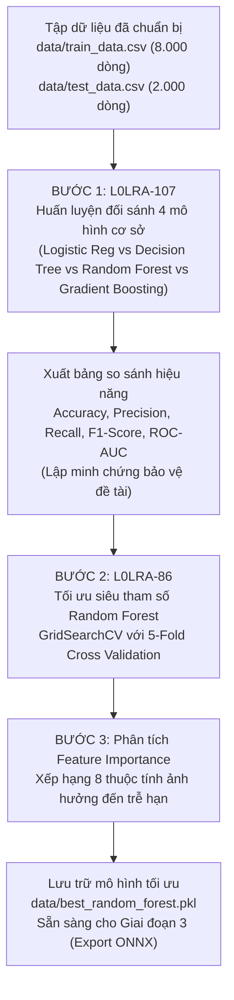

# KẾ HOẠCH HÀNH ĐỘNG CHI TIẾT - GIAI ĐOẠN 2: HUẤN LUYỆN & ĐỐI SÁNH MÔ HÌNH AI

> **Mã công việc Jira:** `L0LRA-107` & `L0LRA-86`  
> **Thuộc Sprint:** 6.1 (Huấn luyện AI)  
> **Mục tiêu kỹ thuật:** Huấn luyện đối sánh 4 mô hình học máy cơ sở và tinh chỉnh siêu tham số Random Forest đạt $F_1\text{-score} \ge 90\%$.

---

## 1. TỔNG QUAN NHIỆM VỤ GIAI ĐOẠN 2

---

## 2. CHI TIẾT TỪNG BƯỚC THỰC HIỆN

### Bước 1: Huấn luyện đối sánh 4 mô hình cơ sở (`L0LRA-107`)
* **Tệp script xây dựng:** `data/compare_baseline_models.py`
* **Mục đích học thuật:** Trả lời câu hỏi kinh điển của Hội đồng phản biện: *"Tại sao nhóm lại chọn Random Forest mà không phải các thuật toán khác?"*.
* **4 mô hình đưa vào đối sánh trên cùng tập Train 8.000 dòng và Test 2.000 dòng:**
  1. **Logistic Regression:** Mô hình tuyến tính phân loại cơ sở (Baseline tuyến tính).
  2. **Decision Tree Classifier:** Mô hình cây quyết định đơn lẻ (CART).
  3. **Random Forest Classifier (Mặc định):** Mô hình quần thể kết hợp nhiều cây (Ensemble Bagging).
  4. **Gradient Boosting Classifier:** Mô hình tăng cường độ dốc (Boosting).
* **Các chỉ số đo kiểm trên tập Test độc lập (2.000 bản ghi):**
  * **Accuracy:** Tỷ lệ phân loại chính xác tổng thể.
  * **Precision (Độ chuẩn xác):** Trong số các ca AI cảnh báo trễ hạn, có bao nhiêu % thực sự trễ hạn.
  * **Recall (Độ phủ/Độ nhạy):** Trong số toàn bộ các ca trễ hạn thực tế, AI phát hiện được bao nhiêu %.
  * **F1-Score (Trung bình điều hòa):** Thước đo cốt lõi cho bài toán mất cân bằng dữ liệu ($F_1 = 2 \times \frac{P \times R}{P + R}$).
  * **ROC-AUC Score:** Khả năng phân tách giữa lớp trễ hạn và đúng hạn.
  * **Training Time:** Thời gian huấn luyện (giây).
* **Đầu ra kỳ vọng:** 
  * Tệp `data/model_comparison_results.csv` và biểu đồ cột trực quan `data/model_comparison_chart.png` (300 DPI) để đưa vào báo cáo chương 6 và slide thuyết trình.

---

### Bước 2: Tinh chỉnh siêu tham số Random Forest (`L0LRA-86`)
* **Tệp script xây dựng:** `data/train_optimize_random_forest.py`
* **Phương pháp tối ưu:** Sử dụng `GridSearchCV` kết hợp kỹ thuật kiểm định chéo phân tầng 5 lượt (`StratifiedKFold(n_splits=5)`).
* **Không gian tìm kiếm siêu tham số (Hyperparameter Grid):**
  * `n_estimators`: `[100, 200, 300]` (Số lượng cây quyết định trong rừng).
  * `max_depth`: `[10, 15, 20, None]` (Độ sâu tối đa của mỗi cây nhằm kiểm soát overfitting).
  * `min_samples_split`: `[2, 5, 10]` (Số mẫu tối thiểu để phân tách một nút nhánh).
  * `min_samples_leaf`: `[1, 2, 4]` (Số mẫu tối thiểu tại nút lá).
  * `class_weight`: `['balanced', 'balanced_subsample']` (Tự động gán trọng số phạt cao hơn cho lớp thiểu số trễ hạn để tối ưu $F_1\text{-score}$).
* **Mục tiêu hàm mất mát:** Tối ưu trực tiếp chỉ số `scoring='f1'` (hoặc `f1_weighted`) để đạt mục tiêu cam kết $F_1 \ge 90\%$.
* **Đầu ra kỳ vọng:**
  * Bộ siêu tham số tốt nhất (`best_params_`).
  * Mô hình hoàn chỉnh được lưu vào `data/best_random_forest.pkl`.

---

### Bước 3: Phân tích độ quan trọng của đặc trưng (Feature Importance)
* Trích xuất trọng số đóng góp từ thuộc tính `feature_importances_` của mô hình Random Forest tốt nhất.
* Xếp hạng tỷ lệ đóng góp của cả 8 đặc trưng:
  1. `HistoricalOverdueCount` (Lịch sử trễ hạn)
  2. `CreditScore` (Điểm tín nhiệm)
  3. `TotalCurrentDebt` (Tiền nợ hiện tại)
  4. `CurrentHoldingBooks` (Số sách đang mượn)
  5. `IsExamSeason` (Mùa thi cử)
  6. `BorrowDurationDays` (Thời hạn mượn)
  7. `MemberType` (Đối tượng bạn đọc)
  8. `Faculty` (Khoa đào tạo)
* **Đầu ra kỳ vọng:** Tệp `data/feature_importance.json` phục vụ giải trình tính minh bạch của AI (Explainable AI).

---

## 3. TIÊU CHÍ NGHIỆM THU GIAI ĐOẠN 2 (ACCEPTANCE CRITERIA)
1. **Có 3 script Python hoàn chỉnh:**
   * `data/compare_baseline_models.py`
   * `data/plot_model_comparison.py`
   * `data/train_optimize_random_forest.py`
2. **Có bảng đối sánh & biểu đồ 4 mô hình:** Bảng `model_comparison_results.csv` và ảnh `model_comparison_chart.png` chứng minh chỉ số của Random Forest vượt trội hơn Logistic Regression và Decision Tree.
3. **Mục tiêu chất lượng đạt chuẩn SMART:** Mô hình Random Forest sau khi tinh chỉnh đạt **$F_1\text{-score} \ge 90\%$** trên tập kiểm thử độc lập 2.000 dòng.
4. **Có tệp mô hình đã huấn luyện:** `data/best_random_forest.pkl` và `data/feature_importance.json`.
5. **Cập nhật đầy đủ:** Ghi nhận vào [`CHANGELOG.md`](file:///c:/Users/aaa/Pictures/SaveCode/LV23-088-Library-Revenue-AI/CHANGELOG.md) và [`AI_USAGE_LOG.md`](file:///c:/Users/aaa/Pictures/SaveCode/LV23-088-Library-Revenue-AI/AI_USAGE_LOG.md).
