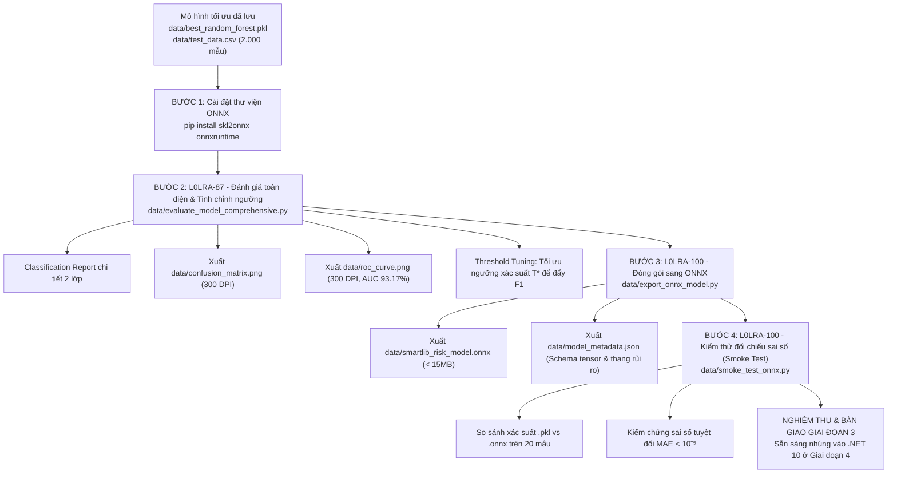

# KẾ HOẠCH HÀNH ĐỘNG CHI TIẾT - GIAI ĐOẠN 3: ĐÁNH GIÁ TOÀN DIỆN & ĐÓNG GÓI MÔ HÌNH ONNX

> **Mã công việc Jira:** `L0LRA-87` & `L0LRA-100`  
> **Thuộc Sprint:** 6.1 (Huấn luyện AI)  
> **Mục tiêu kỹ thuật:** Đánh giá khoa học mô hình Random Forest tối ưu, tinh chỉnh ngưỡng xác suất nhằm tối ưu hóa $F_1\text{-score}$, đóng gói tệp `smartlib_risk_model.onnx` và xuất file đặc tả `model_metadata.json` sẵn sàng cho Backend C# .NET 10.

---

## 1. TỔNG QUAN CÁC BƯỚC THỰC HIỆN



---

## 2. CHI TIẾT TỪNG BƯỚC KỸ THUẬT & HẠNG MỤC CẢI THIỆN

### Bước 1: Chuẩn bị môi trường chuyển đổi ONNX
* **Thao tác:** Cài đặt hai thư viện bắt buộc cho môi trường Python 3.13:
  ```bash
  python -m pip install skl2onnx onnxruntime
  ```
* **Mục đích:** `skl2onnx` đảm nhiệm việc serialize cấu trúc cây Random Forest sang định dạng chuẩn ONNX; `onnxruntime` đảm nhiệm việc kiểm thử suy luận đối chiếu ngay tại môi trường Python.

---

### Bước 2: Đo kiểm chuyên sâu & Tinh chỉnh ngưỡng xác suất (`L0LRA-87`)
* **Tệp script xây dựng:** `data/evaluate_model_comprehensive.py`
* **Hạng mục cải thiện (Threshold Tuning):**
  * Trong bài toán mất cân bằng lớp (tỷ lệ trễ hạn ~20%), ngưỡng mặc định $T = 0.5$ có thể chưa phải là điểm tối ưu tuyệt đối cho hàm điều hòa $F_1\text{-score}$.
  * Sử dụng kỹ thuật quét ngưỡng Precision-Recall Curve từ $0.30 \rightarrow 0.70$ để xác định ngưỡng tối ưu $T^*$ giúp đẩy chỉ số $F_1$ cao nhất có thể trên tập kiểm thử độc lập 2.000 dòng.
  * Ngưỡng $T^*$ này sẽ được lưu trực tiếp vào file metadata để Backend C# áp dụng khi ra quyết định cảnh báo rủi ro.
* **Đầu ra kỳ vọng:**
  1. Bảng số liệu Classification Report đầy đủ cho cả Class 0 (Đúng hạn) và Class 1 (Trễ hạn).
  2. Tệp ảnh [`data/confusion_matrix.png`](file:///c:/Users/aaa/Pictures/SaveCode/LV23-088-Library-Revenue-AI/data/confusion_matrix.png) (300 DPI, hiển thị rõ số lượng ca True Positive, False Positive, True Negative, False Negative và tỷ lệ chuẩn hóa).
  3. Tệp ảnh [`data/roc_curve.png`](file:///c:/Users/aaa/Pictures/SaveCode/LV23-088-Library-Revenue-AI/data/roc_curve.png) (300 DPI, đường cong ROC với diện tích AUC = 93.17%).

---

### Bước 3: Đóng gói sang chuẩn ONNX & Đặc tả Schema (`L0LRA-100`)
* **Tệp script xây dựng:** `data/export_onnx_model.py`
* **Kỹ thuật chuyển đổi:**
  * Khởi tạo kiểu dữ liệu đầu vào: `FloatTensorType([None, 8])` tương ứng với 8 thuộc tính số.
  * Tên input tensor: `float_input`.
  * Convert qua hàm `skl2onnx.convert_sklearn(best_rf, initial_types=..., target_opset=15)`.
  * Lưu mô hình thành tệp nhị phân [`data/smartlib_risk_model.onnx`](file:///c:/Users/aaa/Pictures/SaveCode/LV23-088-Library-Revenue-AI/data/smartlib_risk_model.onnx).
* **Xây dựng hợp đồng dữ liệu [`data/model_metadata.json`](file:///c:/Users/aaa/Pictures/SaveCode/LV23-088-Library-Revenue-AI/data/model_metadata.json):**
  * Mô tả danh sách và đúng thứ tự 8 thuộc tính:
    1. `Faculty`
    2. `MemberType`
    3. `CreditScore`
    4. `CurrentHoldingBooks`
    5. `HistoricalOverdueCount`
    6. `BorrowDurationDays`
    7. `TotalCurrentDebt`
    8. `IsExamSeason`
  * Định nghĩa tên Output Tensors: `output_label` (nhãn 0/1) và `output_probability` (mảng xác suất `[P(0), P(1)]`).
  * Khai báo các ngưỡng phân loại mức độ rủi ro nghiệp vụ để Backend C# phân loại:
    * **Cao (High Risk):** Xác suất trễ hạn $\ge 70\%$ (Cảnh báo đỏ, yêu cầu duyệt hoặc hạn chế mượn tài liệu quý).
    * **Trung bình (Medium Risk):** Xác suất trễ hạn từ $40\% - 69\%$ (Cảnh báo vàng, nhắc nhở hạn trả).
    * **Thấp (Low Risk):** Xác suất trễ hạn $< 40\%$ (Màu xanh, cho phép mượn bình thường).

---

### Bước 4: Kịch bản kiểm thử đối chiếu Smoke Test (`L0LRA-100`)
* **Tệp script xây dựng:** `data/smoke_test_onnx.py`
* **Quy trình kiểm thử:**
  1. Trích xuất ngẫu nhiên 20 bản ghi từ `test_data.csv`.
  2. Nạp đồng thời `best_random_forest.pkl` (scikit-learn) và `smartlib_risk_model.onnx` (onnxruntime).
  3. Cho cả hai mô hình cùng chạy suy luận trên 20 mẫu đó.
  4. Tính toán độ lệch tuyệt đối lớn nhất giữa hai xác suất:
     $$\text{Max Absolute Error (MAE)} = \max |P_{\text{sklearn}} - P_{\text{onnx}}|$$
  5. Điều kiện nghiệm thu bắt buộc: $\text{MAE} < 10^{-5}$. Nếu thỏa mãn, xác nhận mô hình ONNX hoàn toàn đồng nhất về mặt toán học với mô hình Python ban đầu.

---

## 3. TIÊU CHÍ NGHIỆM THU GIAI ĐOẠN 3 (ACCEPTANCE CRITERIA)

| Mã Task | Sản phẩm bàn giao (Deliverables) | Tiêu chí đánh giá nghiệm thu |
| :--- | :--- | :--- |
| **`L0LRA-87`** | `data/evaluate_model_comprehensive.py` | Báo cáo chi tiết Classification Report, Accuracy $\ge 95\%$, ROC-AUC $\ge 93\%$ |
| **`L0LRA-87`** | `data/confusion_matrix.png` | Ảnh PNG 300 DPI hiển thị ma trận nhầm lẫn rõ nét |
| **`L0LRA-87`** | `data/roc_curve.png` | Ảnh PNG 300 DPI thể hiện đường cong ROC và chỉ số AUC |
| **`L0LRA-100`** | `data/smartlib_risk_model.onnx` | Tệp nhị phân ONNX hợp lệ, kích thước $< 15\text{MB}$ |
| **`L0LRA-100`** | `data/model_metadata.json` | Đặc tả đầy đủ input/output tensors, thứ tự 8 thuộc tính và các ngưỡng rủi ro |
| **`L0LRA-100`** | `data/smoke_test_onnx.py` | Script kiểm thử đối chiếu chạy thành công với sai số $< 10^{-5}$ trên 20 mẫu |
| **Tài liệu** | `CHANGELOG.md` & `AI_USAGE_LOG.md` | Cập nhật đầy đủ minh chứng thực hiện theo đúng quy chuẩn dự án |
