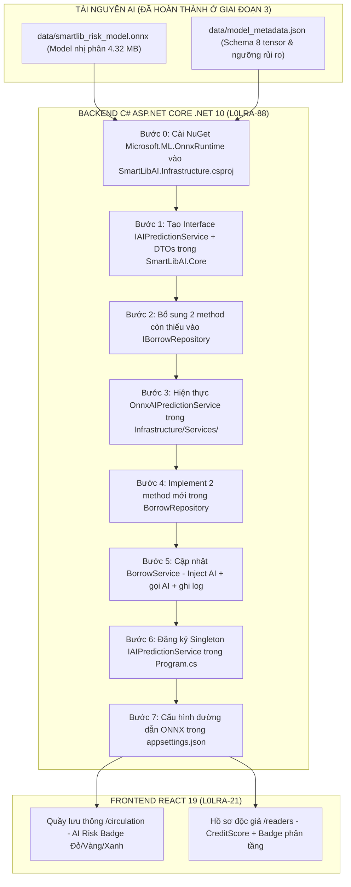

# KẾ HOẠCH HÀNH ĐỘNG CHI TIẾT - GIAI ĐOẠN 4: NHÚNG ONNX VÀO .NET 10 VÀ HIỂN THỊ GIAO DIỆN REACT

> **Mã công việc Jira:** `L0LRA-88` (Backend .NET 10) & `L0LRA-21` (Frontend React)
> **Thuộc Sprint:** 6.3 (Vận hành & Ứng dụng AI)
> **Mục tiêu kỹ thuật:** Đưa mô hình AI `smartlib_risk_model.onnx` vào vận hành in-process trực tiếp trong C# ASP.NET Core .NET 10 qua thư viện `Microsoft.ML.OnnxRuntime` (thời gian suy luận < 1ms) và hiển thị huy hiệu cảnh báo rủi ro AI trực quan trên giao diện Quầy lưu thông (`/circulation`) và Quản lý độc giả (`/readers`).
> **Trạng thái:** v1.1 - Đã review & cập nhật sau kiểm tra code thực tế (2026-10-14)

---

## LỊCH SỬ THAY ĐỔI PLAN

| Phiên bản | Ngày | Nội dung |
| :--- | :--- | :--- |
| v1.0 | 2026-10-13 | Tạo plan ban đầu |
| v1.1 | 2026-10-14 | **Review & sửa** - Thêm Bước 0 (cài NuGet blocker), thêm 2 method còn thiếu vào `IBorrowRepository`, chi tiết inject DI cho `BorrowService`, thêm hướng dẫn cấu hình ONNX path, thêm checklist thứ tự thực hiện |

---

## 1. TỔNG QUAN KIẾN TRÚC TÍCH HỢP IN-PROCESS



---

## 2. RÀ SOÁT CƠ SỞ DỮ LIỆU (DATABASE INTEGRITY CHECK)

* **Xác nhận cấu trúc:**
  * Bảng `AIPredictionLogs` **đã tồn tại sẵn** trong tệp schema `data/01_schema_smartlib_ai.sql` và entity `SmartLibAI.Core/Entities/AIPredictionLog.cs`.
  * Cột `CreditScore` (kiểu `int`, mặc định 100) **đã tồn tại sẵn** trong bảng `Readers` và entity `SmartLibAI.Core/Entities/Reader.cs` dòng 21.
* **Kết luận:** **TUYỆT ĐỐI KHÔNG CẦN THAY ĐỔI CƠ SỞ DỮ LIỆU (DATABASE SCHEMA)**. Toàn bộ các bảng, khóa ngoại và cột cần thiết đã được thiết kế sẵn sàng.

---

## 3. CHI TIẾT TỪNG BƯỚC THỰC HIỆN

### PHẦN 1: BACKEND C# .NET 10 (Task `L0LRA-88`)

---

#### Bước 0 (MỚI - BLOCKER): Cài đặt gói NuGet ONNX Runtime

> **Lý do cần thêm:** `SmartLibAI.Infrastructure.csproj` hiện chỉ có EF Core packages, **CHƯA có** `Microsoft.ML.OnnxRuntime`. Build sẽ lỗi ngay nếu bỏ qua bước này.

* Bổ sung vào `src/SmartLibAI.Infrastructure/SmartLibAI.Infrastructure.csproj`:
  ```xml
  <PackageReference Include="Microsoft.ML.OnnxRuntime" Version="1.20.*" />
  ```
* Chạy kiểm tra: `dotnet restore src/SmartLibAI.sln`

---

#### Bước 1: Định nghĩa Interface & DTOs trong `SmartLibAI.Core`

* **File:** `src/SmartLibAI.Core/Interfaces/IAIPredictionService.cs`
  ```csharp
  public interface IAIPredictionService
  {
      Task<RiskEvaluationResultDto> PredictRiskAsync(ReaderRiskInputDto input);
  }
  ```

* **File:** `src/SmartLibAI.Core/DTOs/AI/RiskPredictionDtos.cs`
  * `ReaderRiskInputDto`: 8 tham số theo đúng `feature_order` trong `model_metadata.json`:
    * Faculty (int: CNTT=0, CoKhi=1, KinhTe=2, Luat=3, NgoaiNgu=4, YDuoc=5)
    * MemberType (int: Lecturer=0, Graduate=1, Student=2)
    * CreditScore (int: 0-100, lấy từ `reader.CreditScore`)
    * CurrentHoldingBooks (int: số sách đang giữ)
    * HistoricalOverdueCount (int: từ `IBorrowRepository.GetOverdueHistoryCountAsync`)
    * BorrowDurationDays (int: 7/14/21/30 ngày)
    * TotalCurrentDebt (double: tổng nợ phạt bằng VND)
    * IsExamSeason (int: 1 nếu Tháng 5 hoặc Tháng 11, ngược lại 0)
  * `RiskEvaluationResultDto`: Trả về `RiskScore` (0.00%-100.00%), `RiskTier` (High/Medium/Low), `BadgeColor` (danger/warning/success), `SuggestedAction`.

---

#### Bước 2 (MỚI - BLOCKER): Bổ sung 2 method còn thiếu vào `IBorrowRepository`

> **Lý do cần thêm:** `IBorrowRepository.cs` hiện có 7 methods nhưng **KHÔNG CÓ** 2 methods dưới đây. `BorrowService` sẽ không biên dịch được nếu thiếu.

* **File:** `src/SmartLibAI.Core/Interfaces/IBorrowRepository.cs`

  **Method 1** - Đếm lịch sử trễ hạn của độc giả:
  ```csharp
  /// <summary>
  /// Đếm tổng số lần độc giả từng trả sách trễ hạn trong lịch sử (ItemStatus = "Overdue").
  /// </summary>
  Task<int> GetOverdueHistoryCountAsync(int readerId);
  ```

  **Method 2** - Ghi nhật ký dự báo AI:
  ```csharp
  /// <summary>
  /// Ghi bản ghi dự báo rủi ro AI vào bảng AIPredictionLogs sau khi tạo phiếu mượn.
  /// </summary>
  Task AddAIPredictionLogAsync(AIPredictionLog log);
  ```

---

#### Bước 3: Tạo thư mục & Hiện thực `OnnxAIPredictionService`

> **Lưu ý:** Thư mục `src/SmartLibAI.Infrastructure/Services/` **CHƯA TỒN TẠI**, cần tạo mới trước.

* **File:** `src/SmartLibAI.Infrastructure/Services/OnnxAIPredictionService.cs`
* **Cơ chế hoạt động:**
  1. Constructor nhận `IConfiguration` để đọc đường dẫn file ONNX từ `appsettings.json` (key: `AI:ModelPath`).
  2. Khi khởi động ứng dụng, nạp `smartlib_risk_model.onnx` vào `InferenceSession` (chỉ nạp 1 lần vì là Singleton).
  3. Tạo `DenseTensor<float>` với shape `[1, 8]` theo đúng thứ tự `feature_order`.
  4. Chạy `session.Run(...)` in-process (không gọi qua mạng, không cần tiến trình ngoài).
  5. Trích xuất xác suất `probabilities[0, 1]` tương ứng với lớp trễ hạn.
  6. Đánh giá rủi ro theo ngưỡng trong `model_metadata.json`:
     * Xác suất >= 70%: Rủi ro Cao (Badge đỏ - `danger`).
     * Xác suất 40%-69%: Rủi ro Vừa (Badge vàng - `warning`).
     * Xác suất < 40%: Rủi ro Thấp (Badge xanh - `success`).

---

#### Bước 4 (MỚI): Implement 2 method mới trong `BorrowRepository`

* **File:** `src/SmartLibAI.Infrastructure/Repositories/BorrowRepository.cs`
* **`GetOverdueHistoryCountAsync`:** LINQ query đếm số `BorrowingDetail` có `ItemStatus = "Overdue"` theo `ReaderId` qua navigation property `Borrowing.ReaderID`.
* **`AddAIPredictionLogAsync`:** `await _context.AIPredictionLogs.AddAsync(log)` + `await _context.SaveChangesAsync()`.

---

#### Bước 5: Cập nhật `BorrowService.cs` & `BorrowReaderEligibilityDto.cs`

**5a. Cập nhật `BorrowReaderEligibilityDto.cs`** - Bổ sung 4 trường AI trả về cho Frontend:
```csharp
// --- AI Risk Assessment Fields ---
public decimal AIRiskScore { get; set; } = 0;
public string AIRiskTier { get; set; } = "Low";
public string AIRiskBadgeColor { get; set; } = "success";
public string? AISuggestedAction { get; set; }
```

**5b. Cập nhật constructor `BorrowService`** - Inject thêm `IAIPredictionService`:

> **Lưu ý:** Constructor hiện tại (dòng 16-19 trong `BorrowService.cs`) chỉ có `IBorrowRepository`. Cần inject thêm.
```csharp
private readonly IBorrowRepository _borrowRepository;
private readonly IAIPredictionService _aiPredictionService;

public BorrowService(IBorrowRepository borrowRepository, IAIPredictionService aiPredictionService)
{
    _borrowRepository = borrowRepository;
    _aiPredictionService = aiPredictionService;
}
```

**5c. Cập nhật `CheckReaderEligibilityAsync`** - Tích hợp AI sau khi lấy thông tin độc giả:
```csharp
// Tổng hợp 8 đặc trưng đầu vào cho mô hình AI
var overdueCount = await _borrowRepository.GetOverdueHistoryCountAsync(reader.ReaderID);
var aiInput = new ReaderRiskInputDto
{
    Faculty                = MapFacultyToInt(reader.Faculty),
    MemberType             = MapMemberTypeToInt(reader.MemberType),
    CreditScore            = reader.CreditScore,
    CurrentHoldingBooks    = currentBorrowCount + 1,
    HistoricalOverdueCount = overdueCount,
    BorrowDurationDays     = standardBorrowDays,
    TotalCurrentDebt       = (double)unpaidFines.TotalUnpaidAmount,
    IsExamSeason           = IsCurrentMonthExamSeason() ? 1 : 0
};
var riskResult = await _aiPredictionService.PredictRiskAsync(aiInput);
dto.AIRiskScore = riskResult.RiskScore;
dto.AIRiskTier = riskResult.RiskTier;
dto.AIRiskBadgeColor = riskResult.BadgeColor;
dto.AISuggestedAction = riskResult.SuggestedAction;
```

**5d. Cập nhật `CreateBorrowAsync`** - Ghi log AI sau khi tạo phiếu mượn thành công:
```csharp
// Ghi bản ghi dự báo rủi ro AI vào bảng AIPredictionLogs
var aiLog = new AIPredictionLog
{
    BorrowingID     = createdBorrowing.BorrowingID,
    RiskScore       = riskEvaluation.AIRiskScore,
    SuggestedAction = riskEvaluation.AISuggestedAction,
    EvaluatedAt     = DateTime.UtcNow
};
await _borrowRepository.AddAIPredictionLogAsync(aiLog);
```

**5e. Helper methods private trong `BorrowService`:**
```csharp
// Mã hóa Faculty sang int theo feature_order trong model_metadata.json
private static int MapFacultyToInt(string? faculty) => faculty?.ToUpper() switch
{
    "CNTT" => 0, "CO KHI" => 1, "KINH TE" => 2,
    "LUAT" => 3, "NGOAI NGU" => 4, "Y DUOC" => 5, _ => 0
};

// Mã hóa MemberType sang int
private static int MapMemberTypeToInt(string memberType) => memberType switch
{
    "Lecturer" => 0, "Graduate" => 1, _ => 2
};

// Kiểm tra tháng thi (tháng 5 và tháng 11 là mùa thi cao điểm)
private static bool IsCurrentMonthExamSeason() => DateTime.Now.Month is 5 or 11;
```

---

#### Bước 6: Đăng ký DI trong `Program.cs`

> **Vị trí thêm:** Thêm NGAY TRƯỚC dòng `builder.Services.AddScoped<IReaderService, ReaderService>()` (dòng 36 hiện tại).

```csharp
// AI Prediction Service - Singleton để InferenceSession chỉ nạp model 1 lần vào RAM khi khởi động
builder.Services.AddSingleton<IAIPredictionService, OnnxAIPredictionService>();
```

Thêm using cần thiết vào đầu `Program.cs`:
```csharp
using SmartLibAI.Infrastructure.Services;
```

---

#### Bước 7 (MỚI): Cấu hình đường dẫn file ONNX trong `appsettings.json`

> **Lý do cần thêm:** `OnnxAIPredictionService` cần biết đường dẫn file ONNX. Đặt vào config để dễ thay đổi theo môi trường (dev/prod).

* Thêm vào `src/SmartLibAI.API/appsettings.json`:
  ```json
  "AI": {
    "ModelPath": "data/smartlib_risk_model.onnx"
  }
  ```
* Đọc trong `OnnxAIPredictionService` constructor:
  ```csharp
  var modelPath = configuration["AI:ModelPath"]
      ?? Path.Combine(AppContext.BaseDirectory, "data", "smartlib_risk_model.onnx");
  ```

---

### PHẦN 2: FRONTEND REACT 19 (Task `L0LRA-21`)

---

#### Bước 1: Cập nhật Giao diện Quầy lưu thông (`CirculationDesk.jsx`)

* **Vị trí hiển thị:** Ngay bên dưới thẻ thông tin độc giả (khi quét mã thẻ thành công).
* **Thành phần UI (AI Risk Assessment Card):**
  * 🔴 **RỦI RO CAO (Risk >= 70%):** Nền đỏ, icon `AlertTriangle`. Thông báo: *"Độc giả có nguy cơ trễ hạn cao ({score}%). Khuyến nghị: Thủ thư yêu cầu xét duyệt đặc biệt."*
  * 🟡 **CẢNH BÁO VỪA (Risk 40%-69%):** Nền vàng, icon `Info`. Thông báo: *"Mức rủi ro trung bình ({score}%). Thủ thư vui lòng nhắc nhở độc giả chú ý thời hạn trả."*
  * 🟢 **ĐỘC GIẢ AN TOÀN (Risk < 40%):** Nền xanh, icon `CheckCircle2`. Thông báo: *"Độc giả uy tín, điểm rủi ro thấp ({score}%). Cho phép mượn sách nhanh."*
  * **Trường API cần map:** `aiRiskScore`, `aiRiskTier`, `aiRiskBadgeColor`, `aiSuggestedAction`.

#### Bước 2: Cập nhật Giao diện Hồ sơ độc giả (`ReaderProfiles.jsx`)

* Bổ sung cột **Điểm tín nhiệm (Credit Score)** và badge phân tầng rủi ro trong bảng danh sách độc giả.
* Trường API lấy từ `GET /api/readers` - kiểm tra response có `creditScore` chưa.

---

## 4. KẾ HOẠCH ĐO KIỂM & XÁC THỰC (TESTING & VERIFICATION)

1. **Kiểm tra biên dịch Backend:** `dotnet build src/SmartLibAI.sln` -> 0 error.
2. **Kiểm tra biên dịch Frontend:** `npm run build` tại thư mục `frontend` -> 0 error.
3. **Kiểm thử API Endpoint:** `GET /api/borrows/eligibility/{readerCode}` - response time < 5ms và `AIRiskScore` khác 0.
4. **Kiểm thử E2E trên Giao diện:** Quét thẻ độc giả có lịch sử nợ/trễ hạn -> Badge đỏ hiển thị đúng thiết kế.

---

## 5. THỨ TỰ THỰC HIỆN CHUẨN (CHECKLIST)

```
[ ] Buoc 0:  Cai NuGet Microsoft.ML.OnnxRuntime -> dotnet restore
[ ] Buoc 1:  Tao IAIPredictionService.cs + DTOs/AI/RiskPredictionDtos.cs
[ ] Buoc 2:  Them GetOverdueHistoryCountAsync & AddAIPredictionLogAsync vao IBorrowRepository
[ ] Buoc 3:  Tao thu muc Infrastructure/Services/ + OnnxAIPredictionService.cs
[ ] Buoc 4:  Implement 2 method moi trong BorrowRepository.cs
[ ] Buoc 5a: Them 4 AI fields vao BorrowReaderEligibilityDto.cs
[ ] Buoc 5b: Inject IAIPredictionService vao BorrowService constructor
[ ] Buoc 5c: Tich hop goi AI trong CheckReaderEligibilityAsync
[ ] Buoc 5d: Ghi log AI trong CreateBorrowAsync
[ ] Buoc 5e: Them 3 helper methods (MapFaculty, MapMemberType, IsExamSeason)
[ ] Buoc 6:  Dang ky Singleton IAIPredictionService trong Program.cs + them using
[ ] Buoc 7:  Them AI:ModelPath vao appsettings.json
[ ] BUILD:   dotnet build -> 0 error
[ ] L0LRA-21: Cap nhat CirculationDesk.jsx - AI Risk Badge
[ ] L0LRA-21: Cap nhat ReaderProfiles.jsx - CreditScore column
[ ] BUILD:   npm run build -> 0 error
[ ] LOG:     Cap nhat CHANGELOG.md va AI_USAGE_LOG.md
```

---

## 6. TIÊU CHÍ NGHIỆM THU GIAI ĐOẠN 4 (ACCEPTANCE CRITERIA)

| Hạng mục | Tiêu chí nghiệm thu |
| :--- | :--- |
| **Backend In-process** | Nạp mô hình ONNX thành công trong C#, độ trễ suy luận < 1ms |
| **Nhật ký AI** | Bản ghi dự báo được tự động lưu vào bảng `AIPredictionLogs` khi mượn sách |
| **Giao diện Quầy lưu thông** | Card cảnh báo rủi ro AI hiển thị sinh động, màu sắc trực quan theo 3 phân tầng |
| **Giao diện Độc giả** | Hiển thị điểm tín nhiệm Credit Score và phân nhóm rủi ro |
| **Quy chuẩn mã nguồn** | Build thành công 100%, cập nhật `CHANGELOG.md` và `AI_USAGE_LOG.md` |
